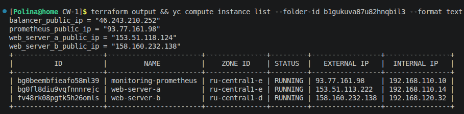
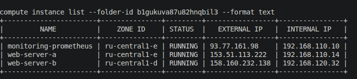
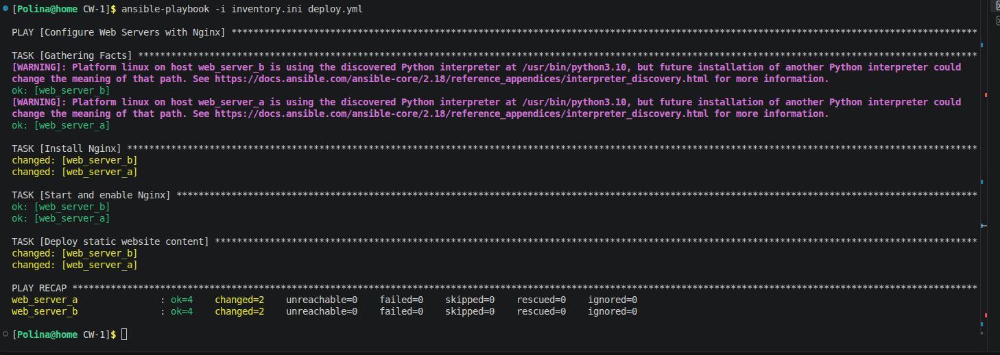
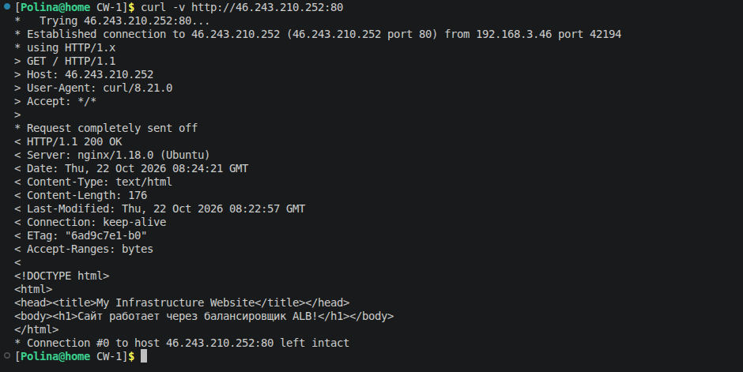

# Контрольная работа — Terraform + Ansible (Яндекс.Облако)

**Автор:** Жихарева Полина
**Папка:** `CW-1/`

## Архитектура

- **ВМ web-server-a** (ru-central1-e) — nginx, Node Exporter, Nginx Log Exporter
- **ВМ web-server-b** (ru-central1-d) — nginx, Node Exporter, Nginx Log Exporter, статический внешний IP
- **ВМ monitoring** (ru-central1-e) — Prometheus (Grafana поставим на отдельную ВМ)
- Network Load Balancer → Target Group из 2 web-серверов (healthcheck `/:80`)

Инфраструктура описана через Terraform (`main.tf`), настройка сервисов — через Ansible:
`deploy.yml` (nginx+сайт), `monitoring.yml` (экспортеры+Prometheus), `logging.yml` (Filebeat).

## 1. Инфраструктура и сайт — ✅

- Создание ВМ через Terraform (Terraform output: IP всех машин, статический у web-b):

- ВМ в разных зонах (ru-central1-e и ru-central1-d), но с идентичной настройкой через один плейбук:

- Установка nginx и деплой статического сайта:

- Проверка сайта через балансировщик:

### ALB-цепочка (по заданию) — ✅

Цепочка целиком в Terraform (`main.tf`):
`yandex_alb_target_group` (обе ВМ по внутренним IP) → `yandex_alb_backend_group`
(backend `:80`, healthcheck `GET /`) → `yandex_alb_http_router` → `yandex_alb_virtual_host`
→ `yandex_alb_load_balancer` (listener `:80`, type auto, 2 зоны).

- Проверка через Application Load Balancer (`51.250.9.248`):

## 2. Мониторинг — 🚧 в процессе

Экспортеры установлены (Node Exporter, nginx-exporter с stub_status на 127.0.0.1:8080), Prometheus собирает 4 таргета.
Осталось: Grafana на отдельной ВМ + дашборды (Utilization/Saturation/Errors: CPU, RAM, диски, сеть, http_response_count_total, http_response_size_bytes) + thresholds.

## 3. Логи — 🚧 в начале

Плейбук `logging.yml` готов (конфиг filebeat, параметризованный ES-host),
осталось: ВМ с Elasticsearch, filebeat-установка (репо Elastic), Kibana.

## 4. Сеть — 🚧 TODO

Единый VPC; web и Prometheus — в приватные подсети, Grafana/Kibana/ALB — публичные;
Security Groups по портам сервисов; отдельная bastion-ВМ (SSH-only).

## 5. Резервное копирование — 🚧 TODO

Snapshot всех дисков, ежедневное расписание, TTL 7 дней.
