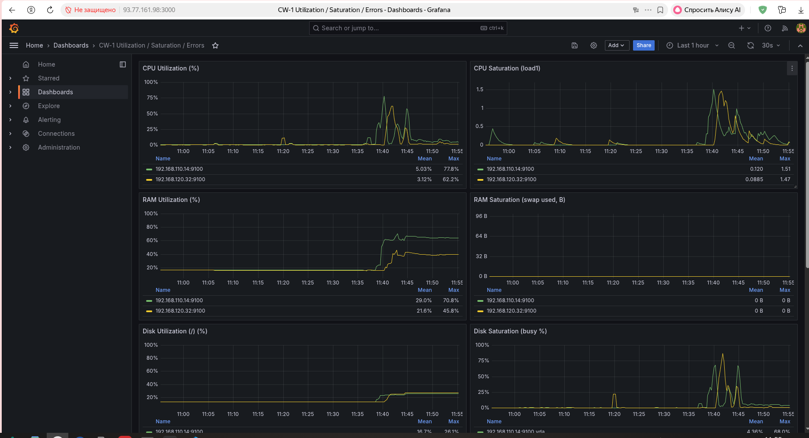
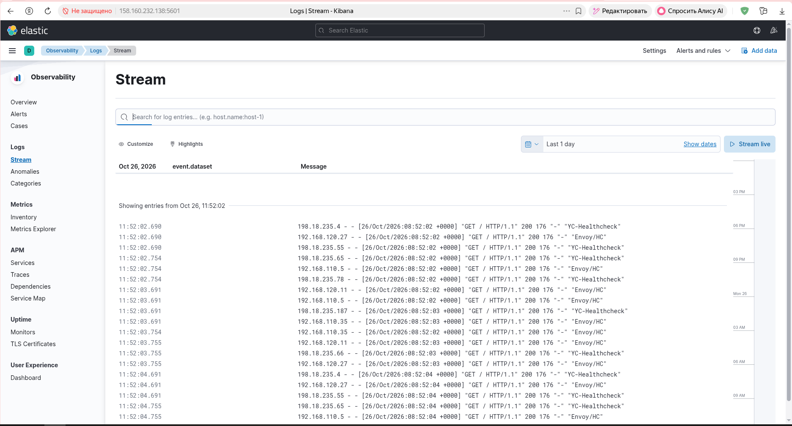
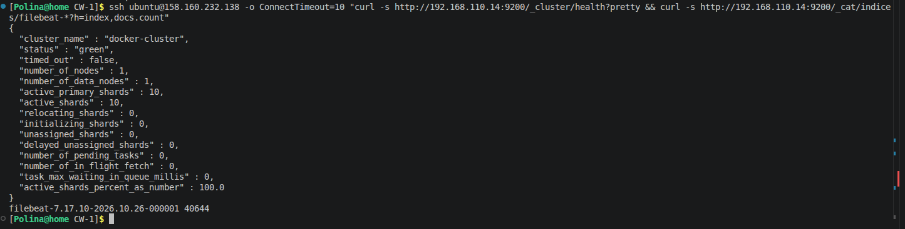
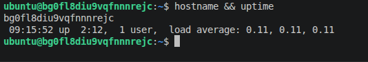
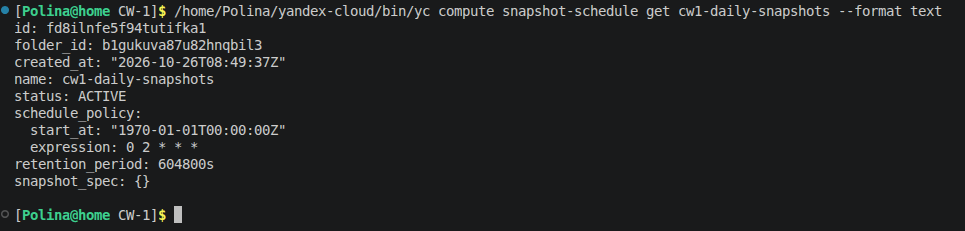

# Контрольная работа — Terraform + Ansible (Яндекс.Облако)

**Автор:** Жихарева Полина
**Папка:** `CW-1/`

## Архитектура

- **ВМ web-server-a** (ru-central1-e) — nginx, Node Exporter, Nginx Log Exporter
- **ВМ web-server-b** (ru-central1-d) — nginx, Node Exporter, Nginx Log Exporter, статический внешний IP
- **ВМ monitoring** (ru-central1-e) — Prometheus (Grafana поставим на отдельную ВМ)
- Network Load Balancer → Target Group из 2 web-серверов (healthcheck `/:80`)

Инфраструктура описана через Terraform (`main.tf`), настройка сервисов — через Ansible:
`deploy.yml` (nginx+сайт), `monitoring.yml` (экспортеры+Prometheus), `logging.yml` (Filebeat).

## 1. Инфраструктура и сайт — ✅

- Создание ВМ через Terraform (Terraform output: IP всех машин, статический у web-b):

- ВМ в разных зонах (ru-central1-e и ru-central1-d), но с идентичной настройкой через один плейбук:

- Установка nginx и деплой статического сайта:

- Проверка сайта через балансировщик:

### ALB-цепочка (по заданию) — ✅

Цепочка целиком в Terraform (`main.tf`):
`yandex_alb_target_group` (обе ВМ по внутренним IP) → `yandex_alb_backend_group`
(backend `:80`, healthcheck `GET /`) → `yandex_alb_http_router` → `yandex_alb_virtual_host`
→ `yandex_alb_load_balancer` (listener `:80`, type auto, 2 зоны).

- Проверка через Application Load Balancer (`51.250.9.248`): 6 запросов, все `200 OK`
(сайт «My Infrastructure Website» отдаётся с обеих ВМ; NLB fallback `46.243.210.252` — тоже 200, см. скрин ниже)

## 2. Мониторинг — ✅

Node Exporter + nginx-exporter (stub_status на 127.0.0.1:8080) на обеих web; Prometheus (`:9090`)
собирает 4 таргета (внутренние IP, конфиг генерируется из inventory).

Grafana — `:3000` на monitoring-ВМ, в docker; datasource и дашборд
(`dashboards/cw-utilization.json`) провижинятся Ansible'ом автоматически
(панели: CPU/RAM/диски/сеть — Utilization/Saturation/Errors + `http_response_count_total`,
`http_response_size_bytes`, thresholds прописаны).

- **Nginx Log Exporter** (helmich, v1.11.0): на обеих web-ВМ — парсит `access.log`,
отдаёт `nginx_http_response_count_total` (rps по `instance`/`method`/`status`)
и `nginx_http_response_size_bytes` (накопленные байты) на `:4040` — питают панели
9–10 дашборда (req/s, avg размер ответа). .deb хранится в репо
(`files/`) и раскатывается Ansible, т.к. GitHub из зоны e флюкает; юниту деба
отдан drop-in override (группа `adm` — в юните срезаны capability root'а).

## 3. Логи — ✅

**Распределение по ВМ (docker из-за дисковых квот Я.Клауд — отдельные ВМ под ES/Grafana
не выделяются, но каждый сервис при этом на своей ВМ):**

- **web-a**: nginx + Elasticsearch 7.17.10 (docker, heap 512M) — `:9200` внутри VPC
- **web-b**: nginx + Kibana 7.17.10 (docker) — `:5601`
- Filebeat: docker на обеих web (логи nginx монтируются внутрь read-only)

Конфиг filebeat генерирует `logging.yml`, ES-host берётся из `inventory.ini`.

Итог: логи access.log/error.log попадают в ES (индекс `filebeat-7.17.10-*`),
Kibana показывает их в UI.

Открывается UI; в Discover — index pattern `filebeat-*` (поле времени `@timestamp`)
с access/error логами nginx с обеих ВМ:

- ES single-node, cluster green, реплики выставлены в 0 (корректно для 1 ноды),
filebeat-индекс ~9.7k документов — вывод той самой ssh-команды:

## 4. Сеть — ✅

Единый VPC (`enp05kgo8tr10hq012cn`), подсети zone e (`192.168.110.0/24`) и zone d
(`192.168.120.0/24`). Всё Тerraform: **4 Security Groups + bastion-ВМ**.

### Security Groups (правило по порту каждого сервиса)

| Группа | Inbound | Outbound |
|---|---|---|
| `sg-alb` | 80, 443 ← anyone | 80 → `sg-web` (healthchecks + бэенды) |
| `sg-web` (обе web-ВМ) | 80 ← anyone; 22 ← `sg-bastion`; 9100/9113 (экспортеры) ← `sg-monitoring`; 9200 (ES) ← приватные подсети (filebeat); 5601 (Kibana) ← anyone | any |
| `sg-monitoring` | 22 ← `sg-bastion`; 9090 (Prometheus), 3000 (Grafana) ← anyone | any |
| `sg-bastion` | 22 ← anyone | any |

### Bastion-ВМ

SSH-only вход в частную сеть: bastion (`178.154.232.162`, zone d) — единственная
машина с открытым 22 портом наружу; у всех остальных ВМ 22-порт разрешён
только для `sg-bastion`. Ansible ходит через `ProxyJump` (см. `inventory.ini`).

- bastion прямое подключение + его использования для jump'а:

### Проверки после добавления SG

- ALB: 200 ×3 через `51.250.9.248`; NLB fallback 200
- Prometheus `up` = 4/4 (scrape-путь по SG-цепочке жив)
- Kibana: 302 наружу, Grafana `/api/health` 200, ES cluster green
- Ansible через bastion: все хосты `pong`

## 5. Резервное копирование — ✅

Snapshot schedule `cw1-daily-snapshots` (Terraform, `fd8ilnfe5f94tutifka1`):
cron `0 2 * * *` (ежедневно 02:00 UTC), retention 168h (7 дней),
все три boot-диска (web-a, web-b, monitoring).

Консоль: Compute Cloud → «Снимки» → вкладка «Расписания снимков» → `cw1-daily-snapshots`:

